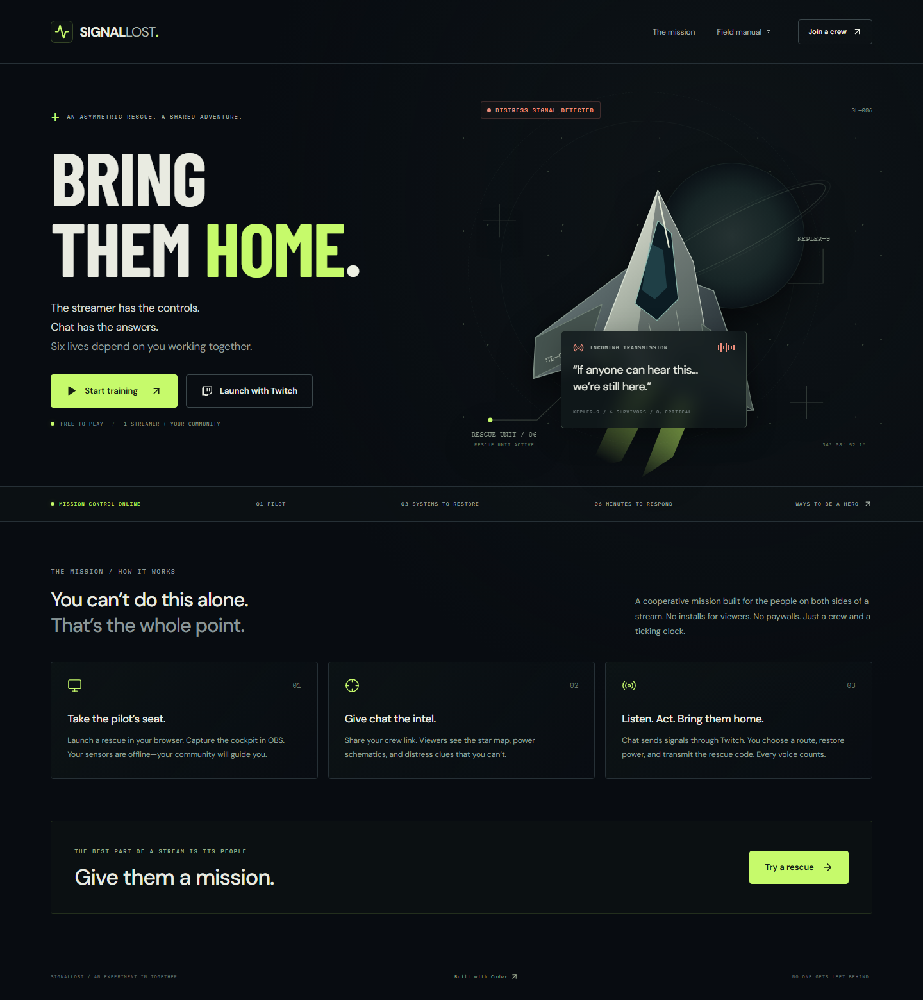

# SignalLost

**The streamer has the controls. Chat has the answers.**

A cooperative Twitch rescue mission: six survivors are stranded beyond the Kepler belt. A streamer pilots a rescue ship with broken sensors while viewers read private telemetry, decode clues, and guide them through Twitch chat.

Built during the Codex × TwitchCon Hackathon submission period, with OpenAI Codex.



## Run locally

Requires Node.js 22 or newer.

```sh
npm ci
npm run dev
```

Open **http://localhost:5173**. Choose **Start training**, launch the rescue, and press **Request simulated intel** for guidance. In the final approach, hold A/D to reach the suggested lane and engage the tractor. **Simulate crew boost** tests the chat power-cell effect. Open the crew link in a second browser for the asymmetric experience.

## Play

1. The streamer shares the room’s **crew intel link** and captures the cockpit in OBS.
2. Viewers identify a safe corridor, solve emergency wiring, and decode distress bands. In Commander, the pilot holds the flight limits and transmission order; both sides must combine their information.
3. Viewers send findings through Twitch chat. The streamer chooses the route, operates relays, and transmits the handshake.
4. The pilot steers the final approach with **A/D or arrow keys**, engages the tractor, and holds the safe lane. A wrong approach heats the beam.
5. Viewers send **`!boost`** to deliver a power cell: six seconds without drift and help for an aligned beam. Three cells per mission, one per viewer.
6. Recover all six named survivors before oxygen runs out. Mistakes cost 20% hull and 20 seconds. The debrief credits the crew and includes the flight recorder.

**Cadet** gives a six-minute guided flight with a calm approach. **Commander** gives five minutes, measured navigation scans, a logical relay schematic, labeled symbol bands, and ion drift during extraction. Training supports both profiles without credentials.

The **crew readback** counts each viewer's latest finding once, so the pilot sees community agreement without spam inflating it. Findings reset for each system.

Viewer commands:

| Command                            | Effect                                           |
| ---------------------------------- | ------------------------------------------------ |
| `!join nav`                        | Join navigation                                  |
| `!join engineer`                   | Join engineering                                 |
| `!join decoder`                    | Join signal decoding                             |
| `!nav VEGA`                        | Send navigation guidance                         |
| `!power A C ON, others OFF`        | Send power guidance                              |
| `!code SUN WAVE STAR MOON`         | Send decoded symbols                             |
| `!code A:SUN B:WAVE C:STAR D:MOON` | Send labeled band meanings for Commander         |
| `!dock 3`                          | Guide the final approach lane                    |
| `!boost`                           | Deliver a community power cell during extraction |
| `!ping your message`               | Send a general signal                            |
| `!help`                            | Display command guidance in the cockpit          |

Finding commands inform the pilot; they never steer or operate cockpit switches. `!boost` directly stabilizes the final approach within its limited cell budget. A 1.5-second cooldown limits each viewer’s signals. Normal conversation is ignored.

## Connect Twitch

1. Register a **confidential** app in the [Twitch developer console](https://dev.twitch.tv/console/apps).
2. Register this exact development redirect URL:
   `http://localhost:3001/auth/twitch/callback`
3. Copy `.env.example` to `.env`, set your client ID and client secret, and keep `APP_URL=http://localhost:5173` for development.
4. Restart the development server. In a rescue room, open **Stream setup → Connect Twitch**.
5. Authorize as the broadcaster whose chat should participate. The application requests only `user:read:chat`.
6. Verify the connected badge, then send `!join nav` from Twitch chat.

Uses Twitch OAuth authorization-code flow and EventSub WebSockets for `channel.chat.message`. No bot account or chat-writing scope is required. Access and refresh tokens remain in server memory, are never returned to the browser, and are discarded on disconnect or server restart.

**A localhost crew link is not accessible to remote viewers.** Use a publicly accessible HTTPS deployment for a real community stream. Deployment instructions and submission materials are in `docs/`.

[Deployment guide](docs/DEPLOYMENT.md) · [Devpost draft](docs/SUBMISSION.md) · [Demonstration script](docs/DEMO_SCRIPT.md)

If you keep the repository private, the hackathon rules require sharing it with **testing@devpost.com** on GitHub or GitLab. Confirm judge access before submitting.

## OBS

Capture the cockpit browser window and toggle **Broadcast layout** for larger, stream-readable text. Alternatively, copy **Stream setup → Copy OBS overlay URL** into a Browser Source at **1920 × 1080**. The transparent overlay shows the objective, countdown, hull, crew link, latest signal, and extraction progress. Keep viewer intel off stream.

## Production

```sh
npm ci
npm run build
npm start
```

Open **http://localhost:3001**. For local production, change `APP_URL` to `http://localhost:3001`. The same Node server serves the compiled frontend, API, OAuth callback, and game WebSockets.

## Validation

```sh
npm run check
npx playwright install chromium
npm run test:e2e
```

`check` type-checks and builds the application, then runs mission-engine tests. Browser tests exercise the full pilot/viewer flow, permissions, reconnects, responsive layout, and OBS output.

Browser tests start a production server on port 4317 to avoid conflicting with normal development. Twitch protocol tests use fixtures; a live broadcaster session must be verified with your own Twitch app before submission.

The quality-upgraded application passed **42 automated tests** and a production Docker build/startup check in [GitHub CI](https://github.com/arnavgupta2004/SignalLost/actions/runs/40651969965). Public-registry audits reported zero vulnerabilities. See the [validation record](docs/VALIDATION.md) and [judging-focused quality review](docs/QUALITY_REVIEW.md).

`npm run format:check` and `npm run check:portability` keep the source reviewable and dependency installation portable.

## Architecture

- **React + TypeScript + Vite:** responsive cockpit, viewer intelligence, training, field manual, and transparent OBS overlay.
- **Node HTTP + WebSockets:** authoritative mission state, bounded JSON requests, and role-specific state projections.
- **Twitch OAuth + EventSub:** real chat input, token refresh, hourly validation, deduplication, and reconnect handling.
- **Original SVG + CSS + Web Audio:** spacecraft, radar, glyphs, animations, and synthesized mission tones.

Room progress is held in memory. Restarting the server clears missions and Twitch sessions. Pilot access is stored in the browser that created the room. The mission automatically pauses when the pilot disconnects for five seconds. A single server process is intended; use a durable shared store before scaling across instances.

## Codex

Codex designed and implemented the mission engine, Twitch integration, interface, original vector assets, and automated tests through iterative development in the hackathon workspace. The entry’s submission materials should include the actual Codex thread ID and footage of the build session. No runtime model API key is needed.

SignalLost's original code and artwork are released under the [MIT License](LICENSE). See [THIRD_PARTY_NOTICES.md](THIRD_PARTY_NOTICES.md) for dependencies and assets.
